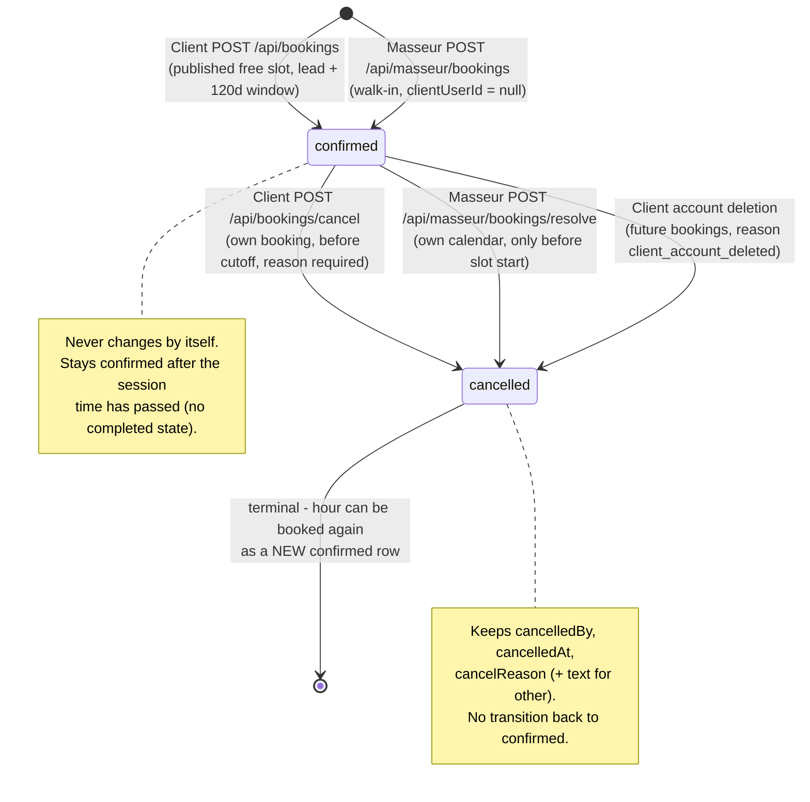

# Booking Lifecycle

> **As-is:** documents the lifecycle the code **implements today**. Binding product rules live in [business-rules.md](business-rules.md#approved-rules) (AR-*) and [decisions.md](decisions.md).
> **Status:** refreshed 2026-11-18 after track-2 closeout (product through [#20](https://github.com/dmytro-koliasa/massagego/pull/20); local Playwright E2E through [#60](https://github.com/dmytro-koliasa/massagego/pull/60)).
> Tags: **Implemented**, **Needs Decision**, **Proposed** (see [business-rules.md](business-rules.md#how-to-read-this-document)).

## 1. Statuses - Implemented

`Booking.status` is the database enum `BookingStatus` with exactly two values ([AR-1](business-rules.md#approved-rules) / [#4](https://github.com/dmytro-koliasa/massagego/pull/4)):

| Status | Meaning today | Written by |
|---|---|---|
| `confirmed` | The booking exists and **occupies the hour** from creation. There is no masseur approval step | Client `POST /api/bookings`; masseur walk-in `POST /api/masseur/bookings` |
| `cancelled` | The booking no longer occupies the hour | Client cancel; masseur resolve; client account deletion (system reason) |

A cancelled row also stores `cancelledBy` (`client` \| `masseur`), `cancelledAt`, `cancelReason` (fixed list), and optional `cancelReasonText` for `other` ([AR-2](business-rules.md#approved-rules), [AR-10](business-rules.md#approved-rules)).

Every non-`cancelled` status occupies the hour in application checks and in the exclusion constraints ([AR-3](business-rules.md#approved-rules)). There are no `completed`, `no_show`, or archive statuses — whether a session took place is derived from time.

## 2. State diagram (implemented behavior)

## 3. Allowed transitions - Implemented

| From | To | Trigger | Constraints |
|---|---|---|---|
| (none) | `confirmed` | Client creates booking | Authenticated client with complete profile; masseur listed; slot published and free; outside lead time and within 120 days (masseur TZ); no client overlap; ≤30 active future bookings; name/phone from account |
| (none) | `confirmed` | Masseur creates walk-in | Slot not started; within working hours 05:00–23:00 (masseur TZ); no active booking; availability row created if missing |
| `confirmed` | `cancelled` | Client cancels own booking | `clientUserId` matches; reason from list (`other` needs text ≤200); `now ≤ slotStart − cancelCutoffHours`; own already-cancelled → success; missing/foreign → same `404` |
| `confirmed` | `cancelled` | Masseur resolves a booking | Own calendar; `slotStart > now`; chooses keep availability or remove it |
| `confirmed` | `cancelled` | Client deletes account | Future bookings only; reason `client_account_deleted`; masseurs notified (event 4) |
| `cancelled` | any | - | **Not possible.** Rebooking inserts a new row |
| `confirmed` | other fields | - | No endpoint edits time, note, type, or status after create |

## 4. Creation - Implemented

1. Authenticate and authorise the actor (client or masseur portal).
2. Validate input with Zod (slots, massage type when required, note).
3. Align each start to the hour in the **masseur time zone**; reject lead-time / window / working-hours / past violations with stable codes (`BOOKING_LEAD_TIME`, `BOOKING_WINDOW_EXCEEDED`, `out_of_hours`, `slot_in_past`, …).
4. Client path: copy `name` + `phone` from the account; refuse incomplete profile (`CLIENT_PROFILE_INCOMPLETE`); refuse unlisted masseur (`MASSEUR_NOT_READY`).
5. In one transaction: take the per-masseur advisory lock; check availability and absence of an active booking; enforce client overlap + cap 30; insert `confirmed`.
6. Conflicts surface as `409 slot_taken` (masseur exclusion constraint) or client codes (`CLIENT_SLOT_OVERLAP`, `CLIENT_BOOKING_LIMIT`).
7. Notifications: enqueue event 1 (new booking → masseur) and confirmation to the client when applicable ([AR-14](business-rules.md#approved-rules)).

Multi-hour client requests create **one booking row per hour**, atomically; there is no booking group id — rows cancel independently. Thai multi-slot is a UX hint only ([BR-014](decisions.md#br-014)), not enforcement.

## 5. Cancellation behavior - Implemented

| | Client cancel | Masseur cancel (`resolve`) |
|---|---|---|
| Endpoint | `POST /api/bookings/cancel` (by `bookingId`) | `POST /api/masseur/bookings/resolve` (by `slotStart`) |
| Who | Booking's own client | Calendar's own masseur |
| Allowed when | Before cancel cutoff; listed reason required | Only if `slotStart > now` |
| After cutoff | Refused (`CANCEL_CUTOFF_PASSED`); UI shows masseur phone when known | n/a |
| Effect on booking | `cancelled` + `cancelledBy=client` + reason fields | `cancelled` + `cancelledBy=masseur` |
| Effect on availability | None — `AvailabilitySlot` remains, hour bookable again | Masseur chooses: `available` (upsert) or `unavailable` (delete) |
| Walk-in bookings | Cannot be cancelled by a client (no `clientUserId`) | Can be cancelled by the masseur |
| Thai neighbour (X-1) | After success, optional `neighborHint` (`thai_neighbor` or `thai_cutoff` + phone) | n/a |
| Notification | Event 2 (client cancel + reason) to masseur | Event 3 (masseur cancel) to client when linked |

Idempotency: cancelling one's own already-cancelled booking succeeds. Missing or someone else's booking returns the same `404 not_found` (C-7).

## 6. Differences between client and masseur workflows

| Aspect | Client | Masseur |
|---|---|---|
| Create | From published free slots outside lead / inside 120 days; several hours at once | Any future in-window hour, one at a time; may create the availability slot |
| Customer data | From account profile | Free-text per walk-in |
| Ownership link | `clientUserId` set | `clientUserId = null` |
| Cancel | Before cutoff + reason | Before start only, with availability choice |
| Visibility of own bookings | Sessions calendar + booking calendar (own booked hours) | Weekly calendar with name, phone, type; recent cancellations list (7 days) |

## 7. Past bookings - Implemented

- Nothing changes status when the session time passes: a past booking stays `confirmed`. There is no `completed` / `no_show` state ([BR-005](decisions.md#br-005)).
- Client booking calendar: free past hours are not offered; **own** booked hours remain visible for cancel attempts (cutoff still applies — past sessions are past cutoff).
- Client sessions list (`GET /api/bookings`): non-cancelled bookings in range; history older than ~3 months may be hard-deleted by cleanup ([AR-16](business-rules.md#approved-rules)).
- Masseur API: cannot resolve/cancel started hours.
- Cancelled bookings without a retention hold are hard-deleted ~7 days after `cancelledAt`.

## 8. Slot availability after cancellation - Implemented

| Cancelled by | Hour afterwards |
|---|---|
| Client | Immediately `available` again (availability row untouched) |
| Masseur, choosing "available" | Immediately `available` again |
| Masseur, choosing "unavailable" | Removed until re-added |

All checks and the PostgreSQL constraints ignore `cancelled` rows, so the same masseur/hour can hold any number of cancelled rows plus **at most one** active row. The same client cannot hold overlapping active hours across masseurs ([BR-008](decisions.md#br-008) / [#9](https://github.com/dmytro-koliasa/massagego/pull/9)).

## 9. Concurrency guarantees - Implemented

- Booking creation takes `pg_advisory_xact_lock(hashtextextended(masseurId, 0))`, serialising writers per masseur.
- Masseur exclusion: `Booking_no_overlapping_active_slots` on `(masseurId, hour-range)` where `status <> cancelled`.
- Client exclusion: `Booking_no_overlapping_active_client_slots` on `(clientUserId, hour-range)` where `clientUserId IS NOT NULL` and `status <> cancelled`.
- Locally verified with concurrent races: exactly one succeeds where required.
- **Not verified on production** (P-1): migration needs `btree_gist`; production `DATABASE_URL` has not been checked in the local-only phase.

## 10. Related decisions (shipped)

Former “open points” for this lifecycle are **Implemented**:

| Topic | Reference |
|---|---|
| Immediate confirm, no post-session statuses | [BR-005](decisions.md#br-005) / AR-1–AR-3 / [#4](https://github.com/dmytro-koliasa/massagego/pull/4) |
| Cancel cutoff, reasons, phone after cutoff | [BR-004](decisions.md#br-004) / AR-10 / [#8](https://github.com/dmytro-koliasa/massagego/pull/8), [#9](https://github.com/dmytro-koliasa/massagego/pull/9) |
| Lead time and 120-day window (no 60-min past grace) | [BR-002](decisions.md#br-002), [BR-003](decisions.md#br-003) / [#8](https://github.com/dmytro-koliasa/massagego/pull/8) |
| Client overlap and cap of 30 | [BR-008](decisions.md#br-008) / [#9](https://github.com/dmytro-koliasa/massagego/pull/9) |
| Notifications on create/cancel (+ reminder, Telegram) | [BR-009](decisions.md#br-009) / AR-14, AR-20 / [#17](https://github.com/dmytro-koliasa/massagego/pull/17)–[#19](https://github.com/dmytro-koliasa/massagego/pull/19), [#27](https://github.com/dmytro-koliasa/massagego/pull/27) |
| Fixed 60-minute sessions | [BR-001](decisions.md#br-001) / AR-5 / [#5](https://github.com/dmytro-koliasa/massagego/pull/5) |
| Thai consecutive-slot hints (no enforcement) | [BR-014](decisions.md#br-014) / [#10](https://github.com/dmytro-koliasa/massagego/pull/10); E2E [#40](https://github.com/dmytro-koliasa/massagego/pull/40), [#41](https://github.com/dmytro-koliasa/massagego/pull/41) |

Still outside this lifecycle doc: deferred prices/payments/courses ([BR-012](decisions.md#br-012), [BR-015](decisions.md#br-015), [BR-016](decisions.md#br-016)); P-1 prod DB verify; P-2 legal.
