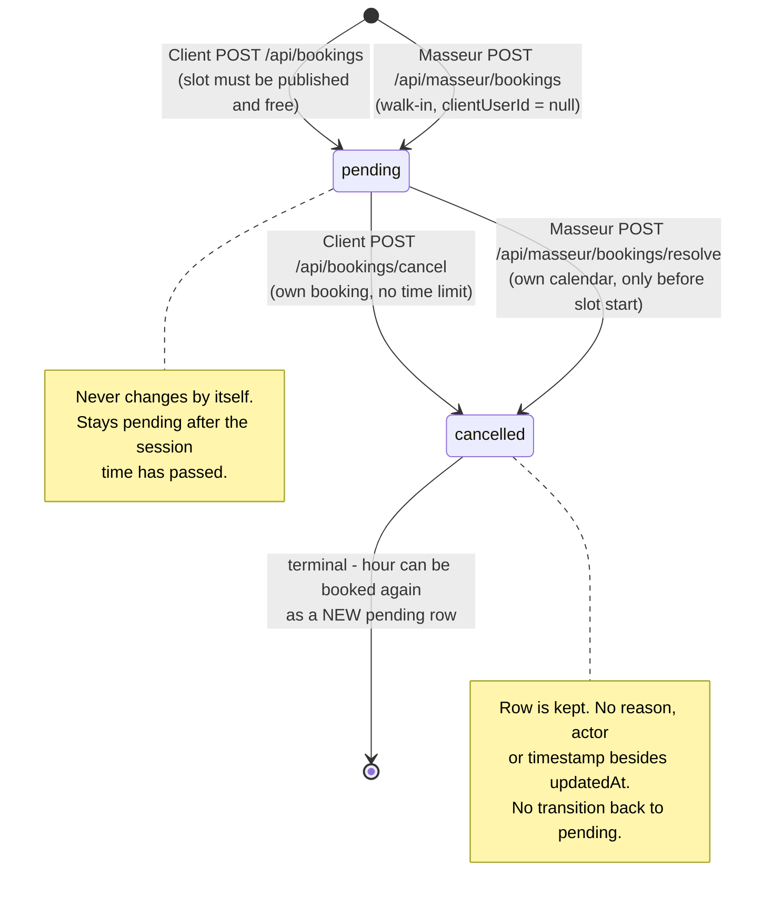

# Booking Lifecycle

> **As-is only:** this document is not an approved requirement; decisions are tracked in [decisions.md](decisions.md).
> **Status:** descriptive snapshot of `master` at commit `f29ca32` (2026-11-15). It documents the lifecycle the code **implements today**; it is not an approved product flow.
> Tags: **Implemented**, **Needs Decision**, **Proposed** (see [business-rules.md](business-rules.md#how-to-read-this-document)).
>
> **Superseded in part ([#4](https://github.com/dmytro-koliasa/massagego/pull/4)):** `status` is now the enum `BookingStatus` with `confirmed` (formerly `pending`) and `cancelled`, and a cancelled booking records `cancelledBy` and `cancelledAt` (approved rules AR-1 to AR-3 in [business-rules.md](business-rules.md#approved-rules)). The sections below still describe the snapshot.

## 1. Statuses - Implemented

`Booking.status` is a **free string** (default `"pending"`); the database does not restrict its values. The code writes exactly two:

| Status | Meaning today | Written by |
|---|---|---|
| `pending` | The booking exists and **occupies the hour**. It is never advanced; there is no confirmation step | Creation (both routes) |
| `cancelled` | The booking no longer occupies the hour | Client cancel, masseur resolve |

Every other string is unknown to the code. Because all "is this hour taken?" checks and the DB constraint use `status <> 'cancelled'`, **any additional status would be treated as occupying the hour**. See [BR-005](decisions.md#br-005).

The name `pending` suggests awaiting approval, but no approval exists: the booked hour is shown as booked immediately, to both parties.

## 2. State diagram (implemented behavior)

## 3. Allowed transitions - Implemented

| From | To | Trigger | Constraints |
|---|---|---|---|
| (none) | `pending` | Client creates booking | Authenticated client; slot published (`AvailabilitySlot`) and free; massage type valid; not older than 60 min past start |
| (none) | `pending` | Masseur creates walk-in booking | Slot not started; no active booking; availability row created if missing |
| `pending` | `cancelled` | Client cancels own booking | `clientUserId` matches; status not already `cancelled`; **no time restriction** |
| `pending` | `cancelled` | Masseur resolves a booking | Booking on own calendar for that exact hour; slot start strictly in the future |
| `cancelled` | any | - | **Not possible.** There is no reactivation; rebooking inserts a new row |
| `pending` | `pending`/other | - | No endpoint edits time, note, type or status |

A second cancellation of an already-cancelled booking is rejected (client: `403 forbidden`; masseur: `404 not_found`).

## 4. Creation - Implemented

1. Authenticate and authorise the actor (client or masseur).
2. Validate input with Zod (name, EU/UA phone, note, massage type, ISO start times).
3. Align each start to the hour; reject slots that already started (client API tolerance: 60 min).
4. In one transaction: take the per-masseur advisory lock; check availability (client route) and absence of an active booking; insert `pending`.
5. A conflicting concurrent request is rejected with `409 slot_taken` (the exclusion constraint is the last line of defence).

Multi-hour client requests create **one booking row per hour**, atomically; there is no booking "group" id, so rows are independent afterwards and are cancelled one by one.

## 5. Cancellation behavior - Implemented

| | Client cancel | Masseur cancel (`resolve`) |
|---|---|---|
| Endpoint | `POST /api/bookings/cancel` (by `bookingId`, or by `masseurId` + `slotStart`) | `POST /api/masseur/bookings/resolve` (by `slotStart`) |
| Who | Booking's own client | Calendar's own masseur |
| Allowed when | Any time, including past and in-progress sessions | Only if `slotStart > now` |
| Effect on booking | `status = 'cancelled'` | `status = 'cancelled'` |
| Effect on availability | None: the `AvailabilitySlot` remains, so the hour is bookable again | Masseur chooses: `available` (slot upserted) or `unavailable` (slot deleted) |
| Walk-in bookings | Cannot be cancelled by a client (no owner) | Can be cancelled by the masseur |
| Notification / reason / fee | None | None |

## 6. Differences between client and masseur workflows

| Aspect | Client | Masseur |
|---|---|---|
| Create | From published slots only; several hours at once | Any future hour, one at a time; creates the slot if absent |
| Customer data | Entered per booking (may differ from the profile) | Entered per walk-in booking |
| Ownership link | `clientUserId` set | `clientUserId = null` |
| Cancel | Anytime | Before start only, with an availability choice |
| Visibility of own bookings | Session calendar (non-cancelled, any range) | Weekly calendar with name, phone and type |

## 7. Past bookings - Implemented

- Nothing changes status when the session time passes: a past booking stays `pending` forever. There is no `completed`, `no_show` or archive state.
- Client booking calendar: past hours are not returned (availability is clipped to "now").
- Client sessions list (`GET /api/bookings`): returns any non-cancelled booking, so past bookings remain visible and can be cancelled.
- Masseur API: cannot resolve/cancel started hours.
- **Implemented:** client cancel cutoff + no post-session statuses ([BR-004](decisions.md#br-004), [BR-005](decisions.md#br-005) / [#8](https://github.com/dmytro-koliasa/massagego/pull/8)–[#9](https://github.com/dmytro-koliasa/massagego/pull/9)).

## 8. Slot availability after cancellation - Implemented

| Cancelled by | Hour afterwards |
|---|---|
| Client | Immediately `available` again (availability row untouched) |
| Masseur, choosing "available" | Immediately `available` again |
| Masseur, choosing "unavailable" | Removed from the calendar until re-added |

All checks and the PostgreSQL constraint ignore `cancelled` rows, so the same masseur/hour can hold any number of cancelled rows plus **at most one** active row.

## 9. Concurrency guarantees - Implemented

- Booking creation takes `pg_advisory_xact_lock(hashtextextended(masseurId, 0))`, serialising writers per masseur.
- `EXCLUDE USING gist (masseurId WITH =, tsrange(slotStart, slotStart + 1 hour) WITH &&) WHERE (slotStart IS NOT NULL AND status <> 'cancelled')` forbids two overlapping active bookings for one masseur.
- Locally verified with 12 concurrent requests and with mixed client/masseur races: exactly one succeeds, the rest receive `slot_taken`.
- **Not verified:** production. Migration `20261115120000_booking_no_overlap` needs the `btree_gist` extension and fails if overlapping active bookings exist; the production state is unknown.

## 10. Open points

| Topic | Reference |
|---|---|
| Is a booking confirmed immediately, or does the masseur approve it? Are `completed`/`no_show` needed? | [BR-005](decisions.md#br-005) |
| Cancellation cutoff, past-booking cancellation, reasons | [BR-004](decisions.md#br-004) |
| Minimum lead time and the 60-minute grace on started slots | [BR-002](decisions.md#br-002) |
| Client overlapping bookings and request size | [BR-008](decisions.md#br-008) |
| Notifications on creation and cancellation | [BR-009](decisions.md#br-009) |
| Session duration | [BR-001](decisions.md#br-001) |
